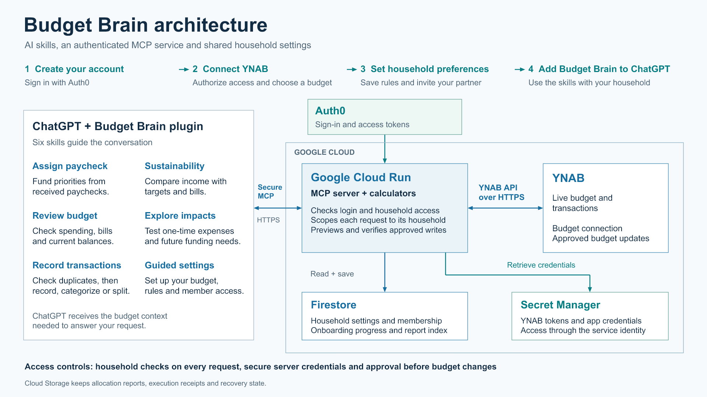

# Architecture

The diagram shows the product architecture. The README's implementation table records what is connected today.

## Conversation and calculation

The plugin packages reusable skills. The assistant first reads the authenticated household's policy and relevant completed history, then reads current YNAB evidence. It uses the server calculators to propose a payday assignment, compare an exception, or assess sustainability.

The calculators are pure functions over a coherent snapshot and explicit inputs. They use integer YNAB milliunits. Input tool amounts use currency units; financial output fields ending _milliunits divide by 1000 for display.

## Identity and scope

Auth0 supplies signed access tokens. auth.mjs checks RS256 signature, issuer, audience, required claims, expiry, and explicit allowed subjects. budget-policy.mjs pins every tool request to the deployment's selected budget. Membership is derived from the verified token, never a caller-supplied identity field.

The current service is scoped to one configured household. Per-user household routing and database-backed membership need implementation before independent households can share the service. An OAuth login by itself does not establish ownership of a budget.

## Settings

Today, household.mjs loads settings, canonical rules, and an imported history index from a private repository. It pins all files to one commit and verifies the budget and approval contract.

The Firestore integration will add household membership, versioned settings and onboarding progress through authenticated server APIs. A user's credentials remain separate from configuration. Provisioning the database alone does not migrate existing files or create these APIs.

## Credentials and persistence

- Secret Manager holds the YNAB credential and private configuration-repository credential.
- The runtime service identity accesses private Cloud Storage through short-lived metadata-service credentials.
- Cloud Storage holds prepared plans, completion reports, write receipts, the shared write lock, and undo state.
- Firestore's household records and report index will make routing and recent-history queries easier without requiring all reports in one document.

Client-facing Firestore rules do not replace authorization in a privileged server. Cloud Run must enforce household membership and scope on every server read/write.

## Execution

1. Resolve material questions and calculate a supported proposal.
2. Prepare the exact signed server preview.
3. Show the proposal and obtain the configured final approval once.
4. Submit the same valid approved preview.
5. Verify the upstream outcome and save completion evidence.

Changed inputs, budget state, household revision, identity, or expiry require a new review. Ambiguous or partial outcomes retain recovery state. The service cannot guarantee bank settlement or atomicity against concurrent changes outside the app.

## Onboarding

The settings webapp will guide account creation, secure YNAB connection, explicit budget choice, household questions, a settings preview, and partner invitations. Guided Settings is the conversational companion to that same API and schema. Existing configured members reuse the household's saved setup.
